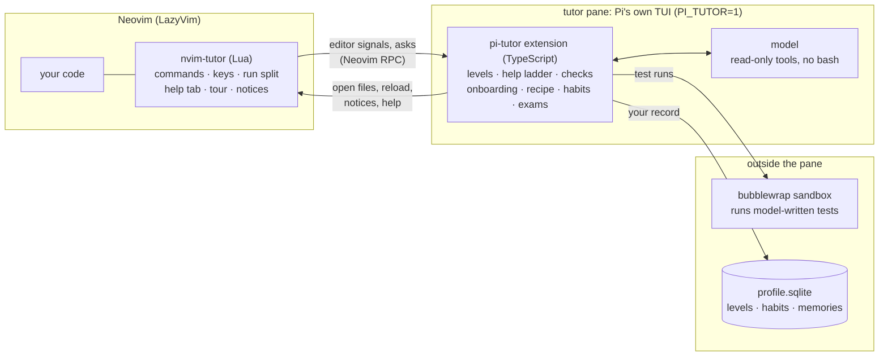
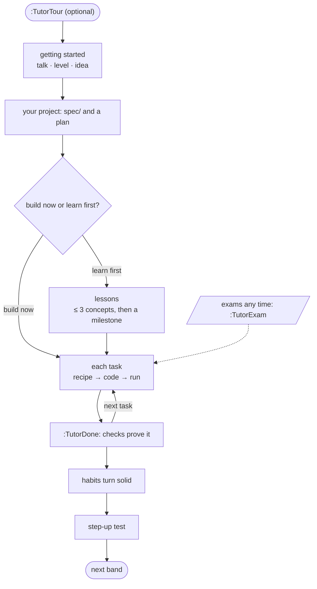
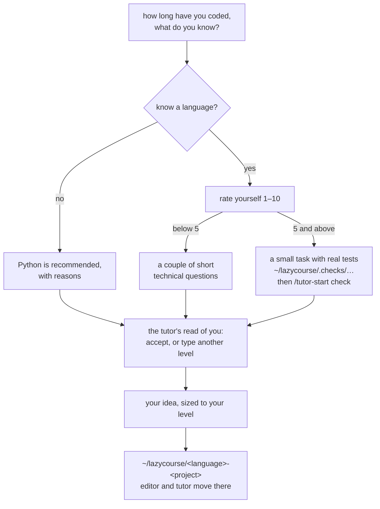
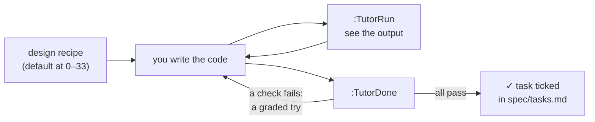
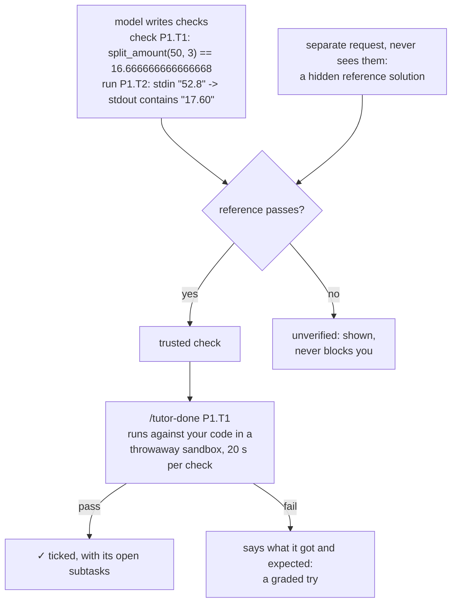
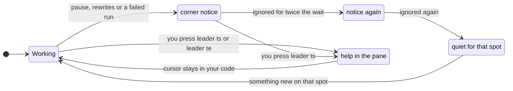

# lazycourse

An AI tutor inside [LazyVim](https://github.com/LazyVim/LazyVim) that teaches you to code by making *you* write the
code.

You pick a language and an idea. The tutor finds your level, turns the idea into a planned project, and coaches you
from a pane next to your code with questions, hints and small unrelated examples.

| Rule | What it means for you |
|---|---|
| **You write the code** | The stuck line is handed over only after real tries, and only when you ask. |
| **Code decides, not the model** | Whether a task is done, how much help you get and when your level moves are all decided by code. |
| **You start the help** | Pauses, rewrites and failed runs only show a small notice. The tutor never talks first. |

---

## Contents

- [How it works](#how-it-works)
- [Install](#install)
- [First steps](#first-steps)
- [A course, start to finish](#a-course-start-to-finish)
- [Working on a task](#working-on-a-task)
- [Getting help](#getting-help)
- [Your level and habits](#your-level-and-habits)
- [Exams and the sandbox](#exams-and-the-sandbox)
- [What the tutor knows](#what-the-tutor-knows)
- [Commands](#commands)
- [Files, tests and layout](#files-tests-and-layout)

---

## How it works



- The tutor exists only in the Pi that the plugin starts (`PI_TUTOR=1`). A plain `pi` elsewhere is untouched.
- The model can only read, inside the project folder: `read`, `grep`, `find`, `ls`, its two memory tools and
  context7's two docs tools. `bash` stays off.
- Projects live in `~/lazycourse/<language>-<project>`; your profile in `~/.local/share/nvim-tutor/profile.sqlite`.

---

## Install

| Need | Version / note |
|---|---|
| Neovim + LazyVim | Neovim ≥ 0.11 |
| Node | ≥ 22.19 |
| Pi | 1.x (verified on 1.5): `npm install -g --ignore-scripts @earendil-works/pi-coding-agent`, or `pi update` |
| A model provider | configured in Pi: `pi`, then `/login` |
| bubblewrap *(optional)* | sandbox for checks and exams (Linux; Arch: `pacman -S bubblewrap`) |

**1.** Log in to a provider (`pi`, then `/login`) and set `defaultModel` in `~/.pi/agent/settings.json` to a model
that provider serves.

**2.** Install the Pi package:

```sh
cd pi-tutor && npm install && pi install "$(pwd)"
```

**3.** Add the plugin to your LazyVim config (`lua/plugins/tutor.lua`):

```lua
return {
  {
    dir = "<repo>/nvim-tutor",
    name = "nvim-tutor",
    lazy = false, -- loads at start: in a tutor project or ~/lazycourse, nvim opens the tutor by itself
    opts = {},    -- auto_open = false turns that off
    config = function(_, o) require("tutor").setup(o) end,
  },
}
```

<details>
<summary>Plugin options</summary>

| Option | Default | What |
|---|---|---|
| `auto_open` | `true` | open the tutor by itself in `~/lazycourse` or a tutor project |
| `width` | `0.45` | the pane's share of the screen |
| `run_cmd` / `test_cmd` | README front matter | the commands `:TutorRun` and `:TutorRun test` use |
| `test_timeout_ms` | `60000` | when `:TutorRun test` is stopped |
| `pi_cmd` | `pi` | how Pi is started |

</details>

### Keys

| Key | Does |
|---|---|
| `<leader>tt` | open or close the tutor pane (`:Tutor`) |
| `<leader>tr` | run your program in a split below (`:TutorRun`) |
| `<leader>ts` | "I'm stuck" on this line (`:TutorStuck`) |
| `<leader>te` | ask about the error under the cursor |
| `<leader>t?` | every command, explained, in its own tab (`:TutorHelp`) |
| `<Esc><Esc>` | in the pane: give Neovim back |
| `<C-w>h` | from the pane: move to your code |
| `Ctrl+J` | in the pane: a new line (or Shift+Enter) |

---

## First steps

```
 ┌─ 1 ──────────────────────┐   ┌─ 2 (optional) ─────────────┐   ┌─ 3 ──────────────────────────┐
 │ mkdir -p ~/lazycourse    │──▶│ :TutorTour                 │──▶│ tell the tutor what you want │
 │ cd ~/lazycourse && nvim  │   │ 18 steps: Neovim basics,   │   │ to learn (or /tutor-start)   │
 │ → the tutor opens itself │   │ then the tutor itself      │   │ → talk · level · your idea   │
 └──────────────────────────┘   └────────────────────────────┘   └──────────────────────────────┘
```

- **Where it opens.** In `~/lazycourse` or a tutor project (even a subfolder), Neovim opens the tutor by itself.
  Anywhere else you get plain Neovim, and a brand-new learner gets a one-line hint about `:TutorTour`. `:Tutor` opens
  the pane anywhere.
- **The tour** checks each step in the editor; the tutor only answers questions about it. It remembers where you
  stopped: `:TutorTour restart` starts over, `:TutorTour off` stops.
- **Where am I, what next?** Every session opens with a three-line card, and the tutor's box always ends with a
  `next: …` line. Both come from code, never from the model.

```
 tutor  try 2 · plan 6/6 · python · lvl 14     ← the tutor's box: what's going on
 stuck: run failed · notices off 4m · judged partial
 next: :TutorRun test, or ask: <leader>ts      ← always one next step
```

---

## A course, start to finish



### Getting started

`/tutor-start [language]` is a conversation, not a form. The model talks; code keeps the checklist, asks for anything
still missing and makes the decisions.



- **Your idea is the project**, titled in your words. An idea too big for your level gets a smaller version of the
  same idea; "Show me something else" lets the tutor suggest another. No idea: it suggests one aimed at your weak
  concepts.
- **The plan is written in the background:** `spec/design.md`, `spec/requirements.md`, `spec/tasks.md` (stable ids like
  `P1.T1`, grouped into milestones when you learn first) and the README front matter (`run:`, `test:`). The README you
  have open updates by itself; with unsaved edits you are told how to see the new one.
- **Starter files:** Rust and Go get a `Cargo.toml` / `go.mod` and an empty `main`; Lua gets a `.luarc.json` naming
  your Lua.
- A second `/tutor-start` is a short check-in. `off` pauses, the next one resumes; `spec` writes the plan again if it
  failed.

### Learn first: lessons

```
 /tutor-lesson next ──▶ exercise in learn/<concept>/ ──▶ /tutor-lesson check ──▶ pass ──▶ next concept
                                                              │                        (≤ 3, then a milestone)
                                                              └─ 2 failures ─▶ a smaller step
 skip: you know it already          review: a concept that's due (spaced repetition, FSRS)
```

Lessons come from openly licensed courses, never written by the model:

| Source | Licence | For |
|---|---|---|
| Exercism | MIT | every language |
| rustlings | MIT | Rust |
| Python tutorial, Go by Example, Node.js docs, Rust Book, Lua manual | PSF, CC BY 3.0, … | reading input and files (excerpts plus our own tested exercises) |

TypeScript and Lua lessons are **thin**: neither has a beginner syllabus upstream (TypeScript reuses the JavaScript
exercises, run as `.ts`; Lua has three concept lessons plus input and files). Each
`pi-tutor/lessons/<language>/SOURCES.md` lists sources, pinned commits, licences and fixes.

---

## Working on a task



### The design recipe

At level 0–33 every task starts it by itself; at any level `/tutor-plan P1.T1` does.

```
 Find ──▶ Shape ──▶ Examples ──▶ Steps ──▶ Map ──▶ Build
 the task  in → out  ≥ 2 cases,  in order  step →   your
 named               one edge              construct code
```

- A step moves on when **your own message** has its artifact, in plain words or code form.
- The tutor shows each step on an unrelated example and never fills yours in. Your Examples rows become checks.
- "skip", "just let me code" or `/tutor-plan next` moves on; `/tutor-plan off` ends it for this task. Neither counts
  as a try. "I don't understand" gets the step in one sentence.

### Running

| | `:TutorRun` (`<leader>tr`) | `:TutorRun test` |
|---|---|---|
| Runs | the README's `run:` command | the `test:` command |
| Shows | a split below the editor; you type its input there | hidden, no input |
| Stops | `:TutorRun stop`, closing the split or Ctrl+C: "run stopped", never a failed try | after 60 s: "timed out", a notice offers help, never a failed try |

`q` closes the split once the program has ended. When the tutor saw you finish a task, the next passing run ticks it
(never while `spec/tasks.md` has unsaved edits).

### Checks prove a task; the tutor never ticks one



- Checks are listed in `spec/checks.md`. Your files are never changed.
- No checks, or no sandbox here: the task ticks as *self-checked*. `/tutor-done P1.T1 anyway` ticks it as yours.
- Rust and Go: your function is also called through a hidden test (only in the sandbox copy).
- **Near-miss guard:** rounded and one-character-slip answers are tried against the checks; if they would pass, the
  tutor asks for one more check.

---

## Getting help

### You start the help, never a timer



- The notice is a small toast in Neovim's corner: "Still on line 42 of solution.py? `<leader>ts` if you're stuck". It
  needs no answer and fades on its own.
- An error that just sits on a line never gets a notice: you ask.
- `/tutor-quiet` (or `:TutorQuiet`) turns notices off for `1m`, `5m`, `10m`, `1h`, or `off` until `/tutor-quiet on`.
  Asking still works while they are off.
- During an exam or step-up there is no help; `<leader>ts` says so. In architect mode the architect answers.

### Help climbs when you ask, after you try

```
 ask ──▶  teach      ──▶  small hint ──▶  why it's   ──▶  "what were you  ──▶  the stuck line
          (unrelated                      wrong            thinking?"          only
           example)
          ▲
          └── each later ask climbs one step only if you tried something since
              (a new failed try, or changed code); otherwise the same step, said another way
```

| Band | Gets the stuck line |
|---|---|
| beginner (0–33) | on the 4th such ask |
| intermediate (34–66) | on the 6th |
| pro (67–100) | only with `/tutor-fix` |

- **Asks** are `<leader>ts` and `<leader>te` (or right-click an error → "Ask tutor about this error"). Chatting in the
  pane talks at the current step.
- **Graded tries** (a failed check from `/tutor-done`, or a `:TutorRun` that fails with anything but a syntax error)
  count for your habits and the box's `try N`, but never move help by themselves.

### Every teaching reply is checked before you see it

```
 model writes ─▶ "tutor is checking this reply…" ─▶ code's rules ─┬─ pass ─▶ you see it
                                                                 └─ fail ─▶ written again (≤ 2) ─▶ else a short safe note
```

- The rules: no code with your task's names before the fix, short enough, a question when it must ask, no talk about
  the tutor's machinery.
- A reply with nothing to read (the answer stayed in hidden thinking) is asked once more ("tutor is writing its
  answer…"), then you get an honest "I lost my answer — please ask again".
- Every reply has one shape: **What's happening** (a narrow diagram), **Why**, **Example**, **What to try**,
  **In short**.
- The model's thinking stays hidden (`/tutor-thinking show` to read it). The tutor's own messages to the model are
  hidden too.

---

## Your level and habits

```
 0 ─────────────── 33 │ 34 ───────────── 66 │ 67 ────────────── 100
 beginner             │ intermediate        │ pro
 explains structure,  │ names concepts,     │ hints only,
 sees your whole      │ points at docs      │ never code
 buffer               │                     │
            ──────────┴─▶ step-up test ─────┴─▶ step-up test
```

The level is per language. `/tutor-level` sets it by hand.

**Habits move it**, recorded by code from what it sees, never from the model's opinion:

| Habit | Seen when |
|---|---|
| tries get closer | each try is nearer a pass |
| questions that help | your next try improves after asking |
| reads errors first | the error was on screen 5 s before you asked |
| small steps | small edits between runs |
| fixes it yourself | you fix a bug before the tutor hands you the line |
| plans become code | your recipe steps turn into passing code |

```
 not yet ──▶ showing ──▶ solid (5 good across 2 projects)
```

- As your band's habits turn solid the level rises inside the band and says why ("level 10 → 14: you ran small pieces
  often"). It never crosses a band edge by itself, and drops 3 only on a streak of tasks that needed the handed line.
- `/tutor-progress` lists habits, hint use over time, exam scores and strong/shaky/weak concepts.

### The step-up (Python, Lua, Rust, Go)

Offered at most once a day once your band's habits are solid. `/tutor-step-up` starts it.

| Part | What |
|---|---|
| 1 · talking test | talk the problem through, then numbered steps and one `pieces:` line, compared with a hidden solution |
| 2 · coding test (`stepup/`) | solve with a module you haven't used, fix one planted bug, build your own plan; intermediate adds your own tests (must catch a broken hidden solution) and clumsy code to improve |

`/tutor-step-up check` shows each part's checks, `/tutor-step-up submit` decides. A pass tells you to type the next
band's level yourself; the tutor never moves you.

### From 34 and 67

- **Your own tests (34+).** Arrange → act → check with the language's test tool. Name a test after its task
  (`test_p1_t1_uneven`, `p1_t1_uneven`, `TestP1T1Uneven`) and `/tutor-done` runs it after the checks pass. A test
  that still passes when code plants a small bug in a throwaway copy does not tick.
- **The pro score (67+).** A task ticked from its checks scores /100 from facts code checks (checks pass, your tests
  pass, they catch a broken version, they cover the task's `done when` calls). Three in a row can suggest a level
  change; you decide. Then at most three design and naming notes (`/tutor-notes off` stops them).
- **Improve it.** `/tutor-improve P1.T2` on a ticked Python task adds edge-case and timed checks (kept only when the
  hidden solution passes them) and measures your code; `/tutor-improve done` measures again and names what changed.

---

## Exams and the sandbox

### Exams

```
 /tutor-exam [small|medium] [topic] ──▶ exam/<nn>-<name>/ ──▶ work (timer in the box) ──▶ /tutor-submit ──▶ grade.md
   brief.md · starter · example tests,                         hints: a question            score /100:
   run once first (a broken exam is replaced)                  or a concept only            80 requirements
                                                                                            20 idiomatic code
```

`/tutor-exam check` runs the examples; `/tutor-exam off` abandons it. Going over time is recorded as late and still
graded. `grade.md` has `file:line` evidence per requirement, the test output, three next fixes and an "In short".

### The sandbox

Every run of model-written tests (checks, lessons, exams, step-up) happens in bubblewrap:

```
 ┌──────────────── sandbox ─────────────────┐     hidden: your home, /tmp, /run (Neovim, agent, Docker,
 │ filesystem: read-only                    │             system-bus sockets), /mnt, /media, /srv
 │ tests work on a throwaway copy           │     no network
 │ env: PATH, HOME, LANG only               │     toolchains in your home (rustup, nvm, pyenv): read-only
 │ limits*: 4 GB memory, 1024 processes     │     * with a systemd user session
 └──────────────────────────────────────────┘
```

Rust keeps one build folder per project in the tutor's cache. `/tutor-exam sandbox` shows whether it can start;
`/tutor-exam sandbox off` runs exam tests as you. `:TutorRun` runs your own commands, so it is never sandboxed.

---

## What the tutor knows

| | |
|---|---|
| **Language packs** | Python, Rust, Go, TypeScript, Lua, JavaScript, plus the editor. Every turn carries a short card: installed version, the project's constraint, formatter, naming, error style, layout, test command, pitfalls, concept tags. |
| **Skills per language** | `tutor-<lang>-cookbook` (a plain step → the idiom, on an unrelated example) · `tutor-<lang>-expert` (patterns and review checklists; Python, Rust, Go, TypeScript adapted from [fullstack-dev-skills](https://github.com/Jeffallan/claude-skills), MIT) · `tutor-<lang>-ref` (official DevDocs at your installed version; `/tutor-docs` re-fetches, pin one in `~/.config/nvim-tutor/sources.json`, e.g. `{ "python": "python~3.12" }`) |
| **Memory** | when you say how you learn or want to be taught, one short fact is saved (never secrets). `/tutor-memory` lists them; pick one to forget it. |
| **Feedback** | `/tutor-feedback too-long\|too-vague\|too-much-help\|good` adjusts style and help, per language inside a project until `good`. |
| **Learned skills** | `/tutor-learn` drafts a skill from your last finished stuck episode; edit and submit to keep it, Esc to discard. |
| **Architect** | `/tutor-architect [question]` switches to an architecture professor (components, data flow, trade-offs, no code) until `off`. |
| **Second checker** | `/tutor-checker <provider/model>` adds a model that reads each reply after code's checks pass; it can only make replies stricter. |

The box's second line says `outside nvim` when Pi runs without Neovim, and `nvim closed` when the editor exited.

<details>
<summary>Docs lookup with context7 (optional)</summary>

The tutor answers from the offline DevDocs copy first. To let it also look up docs DevDocs lacks (third-party
libraries such as `requests` or `serde`), add context7 to Pi once, in `~/.pi/agent/mcp.json`:

```json
{
  "autoEnableCodemode": false,
  "mcpServers": {
    "context7": {
      "url": "https://mcp.context7.com/mcp",
      "exposure": "direct",
      "description": "Up-to-date library documentation"
    }
  }
}
```

- context7 is an outside service: the model's search queries (library names, topics) are sent to it.
- The tutor's Pi starts with an explicit tool list naming only context7's two tools
  (`mcp__context7__resolve_library_id`, `mcp__context7__query_docs`), so no other MCP server, and no `codemode`, can
  reach the model; the tutor's tool guard blocks them as well.

</details>

---

## Commands

`:Tutor…` is typed in the editor, `/tutor-…` in the tutor pane. The one list behind this section, the help tab, the
next-step line and the model's own note is `pi-tutor/commands.json`; a test fails when a command is missing from it,
or from here.

**Start and help**

| Command | Where | Does |
|---|---|---|
| `/tutor-start [language \| check \| off \| spec]` · `:TutorStart` | pane · editor | begin or continue the course |
| `/tutor-help` · `:TutorHelp` · `<leader>t?` | pane · editor · key | the help tab with every command |
| `/tutor-level <0-100>` · `:TutorLevel` | pane · editor | set your level by hand |
| `:TutorTour [restart \| off]` | editor | the tour: Neovim and the tutor, step by step |

**Moving around**

| Command | Where | Does |
|---|---|---|
| `:Tutor` · `<leader>tt` | editor · key | open or close the tutor pane |
| `:TutorRestart` | editor | restart the tutor in its pane |
| `<Esc><Esc>` | tutor pane | leave the pane's typing mode |
| `<C-w>h` | key | move to the window on the left (your code) |
| `q` | run split | close the run split (after the program ends) |

**Coding a task**

| Command | Where | Does |
|---|---|---|
| `/tutor-plan <task id> \| next \| off` · `:TutorPlan` | pane · editor | walk a task from idea to code in six steps |
| `/tutor-done [task id] [anyway]` · `:TutorDone` | pane · editor | check a task and tick it |
| `:TutorRun [run \| test \| stop]` · `<leader>tr` | editor · key | run your program in a split below |
| `:TutorStuck` · `<leader>ts` | editor · key | "I'm stuck": help on this line, cursor stays in your code |
| `<leader>te` | key | ask about the error under the cursor |
| `/tutor-quiet 1m \| 5m \| 10m \| 1h \| off \| on` · `:TutorQuiet` | pane · editor | stuck notices off for a while, or until on (no choice: a picker) |
| `/tutor-fix` · `:TutorFix` | pane · editor | pro only: show the fix for where you are stuck |
| `/tutor-improve <task id> \| done \| off` | pane | make a ticked task's code better, measured |

**Learning paths and tests**

| Command | Where | Does |
|---|---|---|
| `/tutor-lesson next \| check \| skip \| review \| off` · `:TutorLesson` | pane · editor | learn-first lessons with small exercises |
| `/tutor-exam [small \| medium] [topic] \| check \| off \| sandbox on\|off` · `:TutorExam` | pane · editor | a timed exam in this project |
| `/tutor-submit` · `:TutorSubmit` | pane · editor | hand in the exam and get it graded |
| `/tutor-step-up [check \| submit]` · `:TutorStepUp` | pane · editor | step up to the next band |
| `/tutor-architect [question] \| off` · `:TutorArchitect` | pane · editor | talk architecture: parts, data flow, trade-offs |

**Your record and settings**

| Command | Where | Does |
|---|---|---|
| `/tutor-status` | pane | the tutor's current state |
| `/tutor-progress [language]` · `:TutorProgress` | pane · editor | your habits, hint use, exams and concepts |
| `/tutor-memory` | pane | what the tutor remembers about you |
| `/tutor-feedback too-long \| too-vague \| too-much-help \| good` · `:TutorFeedback` | pane · editor | tell the tutor how it is teaching |
| `/tutor-notes on \| off` | pane | design and naming notes after a pro tick |
| `/tutor-thinking auto \| show \| hide` · `:TutorThinking` | pane · editor | show or hide the model's thinking |
| `/tutor-learn` · `:TutorLearn` | pane · editor | keep what you learned from being stuck |
| `/tutor-docs [language]` · `:TutorDocs` | pane · editor | fetch official docs for a language |
| `/tutor-checker <provider/model> \| off` | pane | a second model checks each reply |
| `/reload` · `:TutorReload` | pane · editor | reload the tutor extension |

---

## Files, tests and layout

### Your files

```
~/.local/share/nvim-tutor/
├── profile.sqlite        levels, habits, projects, memories, exam scores, settings (PI_TUTOR_PROFILE overrides)
└── projects.json         project folders; Neovim reads it at start to decide whether to open the tutor
~/lazycourse/
├── <language>-<project>/ README.md (front matter run: / test:), AGENTS.md, spec/, src/, learn/, exam/, stepup/
├── .checks/              the getting-started level tasks
└── .tour/                the tour's practice files and progress (state.json)
~/.pi/agent/skills/tutor-<lang>-ref   fetched official docs
```

### This repo

| Path | What |
|---|---|
| `pi-tutor/` | Pi package: the extension (`extensions/tutor/`), skills, prompts, packs, lessons, `commands.json`. `PI_SURFACE.md` lists every Pi and Neovim API it depends on. |
| `nvim-tutor/` | Neovim plugin: the pane (`term.lua`), commands and start-up (`init.lua`), run split (`runpane.lua`), help tab (`help.lua`), tour (`tour.lua`, `tour/steps.lua`). |
| `docs/superpowers/specs/` | Design specs, from the first design ([`2026-10-07-nvim-tutor-design.md`](docs/superpowers/specs/2026-10-07-nvim-tutor-design.md)) to the tour and wayfinding ([`2026-11-08-wayfinding-and-tour-design.md`](docs/superpowers/specs/2026-11-08-wayfinding-and-tour-design.md)). |
| `docs/superpowers/plans/` | Implementation plans, one per milestone. |

### Tests

| Command (in `pi-tutor/` unless noted) | What |
|---|---|
| `npm test` · `npm run typecheck` | unit tests, plus a real headless Neovim for the link tests; temp folders go under one `/tmp/lazycourse-test-<pid>` and are removed |
| in `nvim-tutor/`: `nvim --headless -u tests/minimal_init.lua -c "PlenaryBustedDirectory tests/ {minimal_init='tests/minimal_init.lua'}"` | the Lua suite |
| `npm run golden` | golden transcripts through the real `pi -p` and your model (network; `GOLDEN_MODEL=provider/id`, `GOLDEN_COLS=n`, default 67). Evidence, not part of `npm test`. |
| `npm run cookbooks` | every cookbook example with the toolchains installed here |
| `npm run lessons` | every lesson and level task (sandboxed when possible): reference passes, starter fails; texts checked for leftover markup and broken links |
| `node scripts/vendor-lessons.ts <language>` | re-vendor a language's lessons from the pinned upstream commits (network) |
| `python3 scripts/gap-lessons.py <sources> lessons` | rewrite the input and files lessons |
| `npm run upstream-diff` | compare the adapted expert skills with a fullstack-dev-skills checkout |
| `SKILL_EVAL_WORKSPACE=<dir>/iteration-N SKILL_EVAL_BASELINE=<checkout without the packs> npm run skill-evals` | skill-creator test runs, each request with and without the pack skills |

### Upgrading Pi

`pi-tutor/PI_SURFACE.md` lists every Pi API this project touches and the version it was verified against.

```
read Pi's CHANGELOG "Breaking Changes" since that version
  ─▶ update PI_SURFACE.md
  ─▶ bump Pi in pi-tutor/package.json (devDependencies; peerDependencies when an older Pi stops working)
  ─▶ npm install ─▶ npm test · npm run typecheck · the Lua suite
  ─▶ one real turn: PI_TUTOR=1 PI_TUTOR_PROFILE=/tmp/p.sqlite pi -p --no-session "Reply with just the word ok."
```

---

## Credits

- The tour's Neovim part is cut down and reworded from Neovim's own tutor (`vim-01/02-beginner`, by Michael C. Pierce
  and Robert K. Ware, modified by Bram Moolenaar, Felipe Morales and Rory Nesbitt), under the Vim license:
  `nvim-tutor/tour/LICENSE-vim.txt`.
- Lessons: Exercism, rustlings, the Python tutorial, Go by Example, the Node.js docs, the Rust Book and the Lua manual
  (see each `pi-tutor/lessons/<language>/SOURCES.md`). Expert skills adapted from fullstack-dev-skills (MIT).
